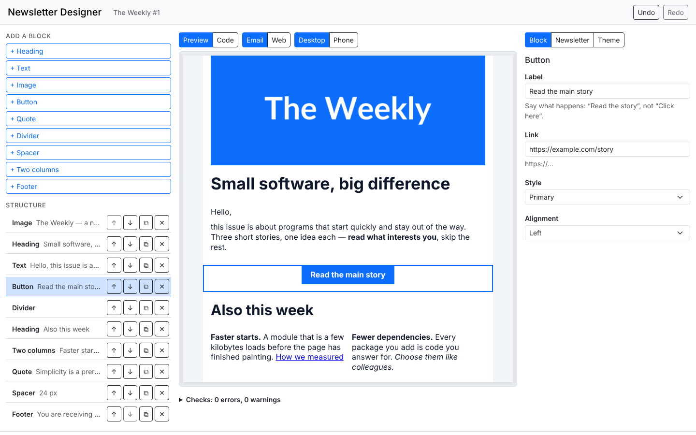

# fsharp-wasm-newsletter

A newsletter designer, written in F# and compiled to WebAssembly GC by [fsharp-wasm](https://github.com/fsharp-wasm/fsharp-wasm).
Build an issue from blocks, see it as the HTML email and as the web version, check it, and export it — HTML, plain text, or the
project as JSON. Everything runs in the browser; there is no server and nothing is uploaded.



## What it does

| | |
|---|---|
| **Blocks** | heading, text, image, button, quote, divider, spacer, two columns, footer. Text takes `**bold**`, `_italic_` and `[links](https://…)`. |
| **Three outputs** | the **email** (the grid and components of [Foundation for Emails](https://github.com/foundation/foundation-emails), MIT, written as typed F#: nested `role="presentation"` tables, the 12-column grid that stacks below its breakpoint, every style inlined, a hidden preheader), the **web version** (semantic HTML with the framework's own class names), the **plain-text** alternative. |
| **A configurable profile** | **Bootstrap 5.3** by default (its palette and type, and its class names for the web version), **Tailwind CSS 3** as the second profile, **Custom** for your own. A profile is design tokens + a class map + a stylesheet/script address; every part is editable, and a profile is a JSON file you can export and import. |
| **Checks** | subject, preheader and language; alternative text for every image; button and text contrast (WCAG 1.4.3, computed from your tokens); heading order; vague link labels; a footer with an unsubscribe link and an address; Gmail's 102 KB clipping limit. Each finding names its block and jumps to it. |
| **Editing** | click a block in the preview or the structure; move, duplicate, delete; undo and redo (typing into one field is one step); phone width; the project is kept in the browser and survives a reload. |
| **Keyboard and screen reader** | everything is reachable and named; changes are announced in a live region; axe-core (WCAG 2.0/2.1/2.2 A and AA) finds no violation on the block, newsletter and theme panels (`tests/e2e/designer.mjs`; automated checks find a minority of problems: a screen reader pass is still to do). |

### Which framework, and what "configurable" means

The designer's own interface is plain **Bootstrap 5.3** — deliberately not the look of this organisation. The *newsletter* you design is
another matter, and Bootstrap is not made for email: mail clients ignore external stylesheets and, in Outlook's case, do not know Flexbox or
Grid. So:

* The **email** is built on **Foundation for Emails**' tables (see [its documentation](https://github.com/fsharp-wasm/fsharp-wasm-core/blob/develop/docs/ui.md)): the stylesheet is a function of the profile's
  **tokens** (colours, font stack, base size, corner radius, content width) and an inliner writes it into the elements. The Bootstrap profile
  carries Bootstrap's palette (`#0d6efd`, `#212529`, …), so the email looks like a Bootstrap page without using a line of Bootstrap CSS.
* The **web version** is real Bootstrap (or Tailwind): it links the stylesheet and uses the **class map** (`btn btn-primary`, `container`, …).
* **Custom** starts as a copy of Bootstrap with no stylesheet and empty class names: fill in your design system's classes and address.

The Tailwind profile loads Tailwind's browser build (the "Play CDN"), which Tailwind documents as a development tool; for production
compile your own CSS and put its address in the stylesheet field.

## Run it

```bash
git submodule update --init                    # lib/runtime (HTML/Elmish library + JS glue), lib/fsharp-wasm-core, lib/wasmecto
source build/env.sh                            # FSHARP_WASM_CORE_DIR

# the 53 checks of the newsletter library (and the 29 of the libraries it uses, which run in fsharp-wasm-core), under .NET
bash build/test.sh dotnet

# as WebAssembly GC: a compiler and wasm-tools
export FSHARP_WASM_DIR=/path/to/fsharp-wasm    # a checkout (needs FSHARP_COMPILER = its patched fsc.dll), or
export FSHARP_WASM_BIN=/path/to/fsharp-wasm    # the binary of a release
bash build/test.sh wasm                        # the same checks compiled to WasmGC and run in Node
bash build/build.sh                            # dist/NewsletterDesigner.wasm
bash build/serve.sh                            # http://127.0.0.1:8080/web/
bash build/site.sh && node build/serve-site.mjs  # the deployable site, under the production headers (docs/deploy.md)
npm ci && node tests/e2e/designer.mjs         # the designer in Chromium (Playwright)
```

## Layout

| path | what it is |
|---|---|
| `lib/fsharp-wasm-core` | submodule: the standard libraries this program is built on — `FSharp.Wasm.Data` (JSON, numbers) and `FSharp.Wasm.Ui` (typed CSS and HTML, the inliner, Foundation for Emails as F#; [documentation](https://github.com/fsharp-wasm/fsharp-wasm-core/blob/develop/docs/ui.md)) — and the base library the compiler needs. |
| `src/Newsletter.Core` | the library, pure F#: `Model` (blocks, fields, operations), `Profile`, `Markup`, `Render` (email on `Ink`, web, text), `Codec`, `Lint`, `Color`, and `Studio` — the designer as a state machine (`update` is pure and says which effects to carry out). Runs under .NET and as WasmGC. |
| `src/Newsletter.Designer` | the interface: `View` (Bootstrap markup on the `Browser.Html` DSL) and `NewsletterDesigner` (hosts the program, local storage, clipboard). Compiled to `dist/NewsletterDesigner.wasm`. |
| `web/` | the page, a few lines of CSS, a local copy of Bootstrap 5.3.3 (MIT, `web/vendor/bootstrap`). The page does two things for the module: it relays clicks from the sandboxed preview frame and it starts downloads. |
| `tests/Newsletter.Tests` | the suites, written with [Wasmecto](https://github.com/fsharp-wasm/fsharp-wasmecto); `Newsletter.WasmTests` compiles the same file to WasmGC. |
| `tests/e2e/designer.mjs` | the compiled designer driven in Chromium: editing, undo, keyboard, import/export, reload, axe-core. |
| `lib/runtime`, `lib/wasmecto` | submodules: the HTML/Elmish library and JS glue, the test framework. |

The design decisions and what is not in the MVP are in [docs/design.md](docs/design.md).

## Licence

Apache License 2.0 (see `LICENSE`, `NOTICE`). The local copy of Bootstrap keeps its own MIT licence (`web/vendor/bootstrap/LICENSE`); the email stylesheet comes from `FSharp.Wasm.Ui` in fsharp-wasm-core, which ports Foundation for Emails (MIT; the text is in `licenses/foundation-for-emails-LICENSE.md` here and in core).
